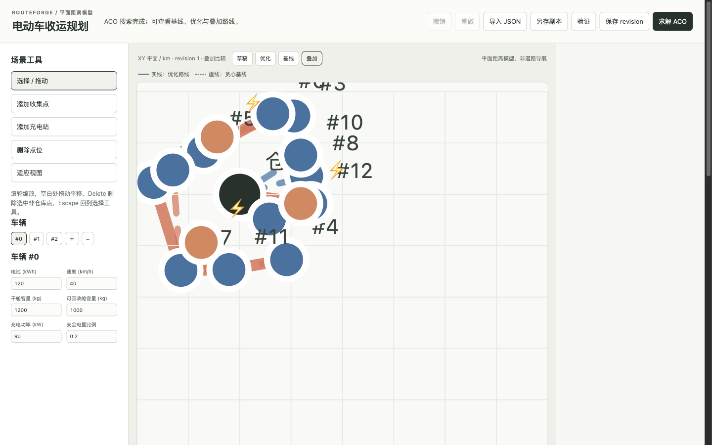

# RouteForge

**Plan electric collection routes under battery, charging, time-window, and two-compartment constraints, and get the diagnostics that show why a plan is or is not feasible.**

RouteForge models two independent payload compartments, load-dependent energy use, charging stations, and service windows, and searches with a constraint-driven ant-colony metaheuristic. Every result carries the route, cost decomposition, convergence history, and explicit constraint diagnostics, so an infeasible plan explains itself instead of disappearing.

## 本地 API 工作台后端

先构建工作台客户端，再从同源启动 API 和前端：

```bash
cd web && pnpm install --frozen-lockfile && pnpm build
cd .. && uv run routeforge serve --host 127.0.0.1 --port 5203 --runtime-dir runtime/routeforge
```

`POST /api/v1/scenarios` 创建不可变场景 revision；`PATCH /api/v1/scenarios/{id}` 必须带
`If-Match`。`POST /api/v1/solve-runs` 返回 `202` 与 job id，随后通过
`GET /api/v1/solve-runs/{id}` 查询，或连接
`GET /api/v1/solve-runs/{id}/events` 接收可重放 SSE（`Last-Event-ID` 可断线续读）。
`POST /api/v1/solve-runs/{id}/cancel` 会在当前完整 ACO iteration 后停下，并保存
`complete=false` 的最后完整结果；重启服务遗留的运行任务标为 `interrupted`。每个完成或取消
的结果都登记为可下载 JSON artifact，供后续工作台和导出流程使用。

这是平面距离实验工具，不是道路导航或生产调度。为使取消在交互中可预期，API 会拒绝超出
本地工作量预算的 customer × ants × iterations 组合，并提示应缩小哪一项。

工作台同源服务于根路径 `/`；它支持点位和车辆约束编辑、JSON 导入、草稿验证、revision 保存、
滚轮缩放/平移和移动端“点位 / 约束 / 方案”页面。编辑中的草稿不会改写既有方案；保存后才生成
新 revision，冲突时可保留当前草稿并另存副本。

生产客户端构建输出到 Python 包的 `static/` 目录并进入 wheel，所以独立安装后的
`routeforge serve` 不依赖旁边的 `web/` 源目录。



实线表示 ACO 优化路线，虚线表示同一次求解生成的 greedy 基线；同一车辆在两层中使用相同颜色。截图来自 12 客户合成场景，数字可由 `uv run routeforge demo --seed 17` 复现，不代表道路导航或真实车队结果。

The solver and evaluator use only the Python standard library. The local workbench adds the declared FastAPI and uvicorn dependencies; `uv sync` installs them without a solver service, broker, database server, or hidden dataset.

## Quick start

Requires Python 3.11+ and [uv](https://docs.astral.sh/uv/).

```bash
uv sync --extra dev
uv run routeforge demo --output-dir outputs/demo
open outputs/demo/report.html
```

The command generates a seeded 12-customer instance, solves it with a compact state-aware ACO run, and writes:

- `instance.json` — the complete generated instance and cost model;
- `result.json` — the plan, baseline comparison, convergence history, and metrics;
- `routes.csv` — one row per vehicle route;
- `stops.csv` — canonical stop-by-stop time, battery, charging, and dual-load trajectory;
- `report.html` — a static route map, convergence plot, cost cards, and diagnostics.

For a repeatable comparison and stability record:

```bash
uv run routeforge benchmark --output-dir outputs/benchmark --seed 17
uv run routeforge sweep --output-dir outputs/sweep --seeds 17,29,41
```

The benchmark compares the same ACO and deterministic greedy baseline on a
12-customer compact case plus a 30-customer stress case. It writes JSON, CSV and
Markdown artifacts plus a SHA-256 manifest; the sweep repeats both cases over
explicit seeds. At seed 17 both plans serve every customer and **both are
feasible**, which is the only condition under which the comparison means
anything:

| case | ACO | greedy | improvement |
|---|---:|---:|---:|
| compact (12 customers) | 475.215086 | 845.147057 | 43.77% |
| stress (30 customers) | 1482.194033 | 1546.546774 | 4.16% |

Across the eight benchmark seeds at both scales the improvement runs from 0.00%
to 43.77%. Read it as "better than this specific greedy constructor on this
synthetic instance", nothing more.

An earlier version of this README quoted `503.862018` against `10734.222441` for
the compact case. That gap was not a routing result: the greedy baseline was
infeasible there, because the builder checked whether a vehicle could reach the
next customer but never reserved energy to get home, and a single 10,000
infeasibility penalty was 93% of the quoted difference. The builder now checks
the return leg and diverts to a charger when it has to, so the greedy baseline is
feasible on all sixteen benchmark instances and the numbers above are routing
costs. `tests/test_return_leg.py` keeps it that way.

Solve a custom instance:

```bash
uv run routeforge solve --customers 30 --chargers 5 --vehicles 5 \
  --seed 7 --ants 24 --iterations 50 --output-dir outputs/large
```

## Model and algorithm

Each customer has dry and recyclable demand plus a service window. A vehicle tracks both compartment loads, battery, clock, and travel distance. Energy is `distance × (base rate + load factor × current load)`. Capacity and battery safety are hard constraints during candidate selection; lateness remains a priced ranking signal, but any late plan is reported as infeasible rather than receiving a misleading pass label.

Every generated route records its source vehicle explicitly. This matters when a
vehicle stays idle: replay never reassigns a later route merely because it
appears first in the route list.

At a charger, RouteForge estimates the remaining work and charges only to the target needed for that work plus a safety margin. A critically low battery triggers a full charge. This policy is shared by the solver and evaluator, so the report describes the same behavior that generated the plan.

Ants filter candidates through capacity, battery, and latest-service checks before calculating a distance/urgency heuristic, then select by roulette wheel over `pheromone^alpha * heuristic^beta`. Evaporation has a floor and deposits have a ceiling, so pheromone stays bounded. A deterministic greedy plan is retained as a baseline, and a bounded swap local search can improve the best ACO plan. The pheromone tensor's battery dimension is measured, not assumed: see the ablation below.

## The pheromone ablation, and what it found

The pheromone tensor is indexed by `(from_node, to_node, battery_level)`. That
battery dimension is the project's distinguishing idea, so it is tested rather
than asserted. `state_aware=False` collapses the tensor to a plain
`(from, to)` matrix and everything else is held identical, including the
per-ant random stream:

```bash
uv run routeforge ablation --output-dir outputs/ablation
```

Over eight fixed seeds at two scales, the measured result is:

| scale | state-aware cheaper | flat cheaper | ties | mean cost delta |
|---|---:|---:|---:|---:|
| compact (12 customers) | 2 | 2 | 4 | +0.052807 |
| stress (30 customers) | 2 | 6 | 0 | -19.963170 |

A positive delta would favour the state-aware tensor. Both are negative, so the
recorded verdict is **not supported**: the battery-state dimension is not a
demonstrated improvement at these scales. The tensor stays the default because
it is the hypothesis under test, and the ablation is the evidence about it.

What this project does establish is the constraint model, the diagnostics, and a
reproducible experiment harness, not that this metaheuristic beats anything.

## Scope and limits

- **The only baseline is a deterministic greedy constructor.** There is no exact
  solver, no OR-Tools comparison, and no published benchmark instance, so
  nothing here bounds the optimality gap. Read the improvement percentage as
  "better than this specific greedy plan", nothing more.
- **Instances are synthetic and self-generated.** No real geography, traffic,
  temperature, or gradient is modelled; energy is a linear load term.
- **Objectives are combined as a weighted sum with large penalties.** There is
  no Pareto front and no weight sensitivity analysis.
- **Scale is 12 and 30 customers.** Plan evaluation is pure Python and re-runs
  for every local-search candidate.
- **Local search is intra-route swap only** — no segment reversal, relocate, or
  inter-route exchange.
- **Parameters are conventional, not tuned.** Only the battery-state dimension
  has been ablated.
- Compare plans only when instance, fleet, cost model, seed, iteration budget,
  and package version are held constant. Invalid or incomplete plans stay
  visible in `result.json` with missing customers and violation messages.

Every decision above, the alternatives rejected, and the remaining weaknesses
are written out in [docs/design-decisions.md](docs/design-decisions.md).

## Development

```bash
uv run pytest
uv run --with ruff ruff check src tests
uv lock --check
uv build
uv run routeforge benchmark --output-dir outputs/benchmark --seed 17
uv run routeforge ablation --output-dir outputs/ablation
uv run routeforge sweep --output-dir outputs/sweep --seeds 17,29,41
```

`benchmark` and `sweep` are fast. `ablation` runs four solves per seed and takes
about twenty seconds; repeated runs are byte-identical, including the manifest.

See [docs/architecture.md](docs/architecture.md) for state transitions and [CONTRIBUTING.md](CONTRIBUTING.md) for the contribution boundary.

## Scope

RouteForge is an independent implementation. It includes no client code, client data, client assets, private prompts, or copied source files. The domain model re-expresses general electric-routing experience.

## License

MIT; see [LICENSE](LICENSE).
